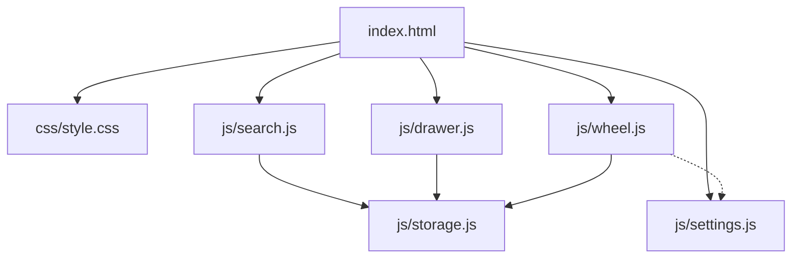

# CODEMAP.md

## 🧱 Project Structure

## 🎨 Core Design Systems

### 1. Premium Glassmorphism
- **Context**: Centered search box and radial wheel disc with adaptive background blurring.
- **Variables**: `--search-top`, `--search-left`, `--glass-blur`, `--wallpaper-blur`.
- **Transitions**: Smooth layout initialization via `preload.js` to prevent FOUC.
- **Background Layers**: `#bg-color-layer` owns the solid transition color, while `#bg-layer` owns only wallpaper imagery above it.

### 2. Tabula Icon Engine (v3.0)
- **Tech Stack**: CSS Masks + Multi-browser compatible inline SVGs.
- **Logic**: Shared `getIconHTML` engine (JS) for dynamic lists and static CSS classes (HTML) for global data actions.
- **Inheritance**: Icons automatically inherit the parent's `color` and `opacity`.

## ⚙️ Core Modules

- **js/wheel.js**: Quicker-style left-click long-press radial bookmark menu (5-state Pointer machine, dual origins, muscle-memory stable 8-direction slots, sector retention hysteresis).
- **js/search.js**: Handles command extraction (`/`), multi-term delimiter splitting (`,`), frequency-scored bookmark retrieval, spatial-aware dropdown flipping, and `dismiss()`.
- **js/storage.js**: Adapts to `chrome.storage.local` with fallback to `localStorage`.
- **js/settings.js**: Single config owner (`tabula_config`), owns visual settings, wheel menu configuration & slot binding, backup/restore, and Odin bookmark sync.
- **js/drawer.js**: High-performance bookmark management & full data backup (Export/Import), with `isOpen()` status detection.
